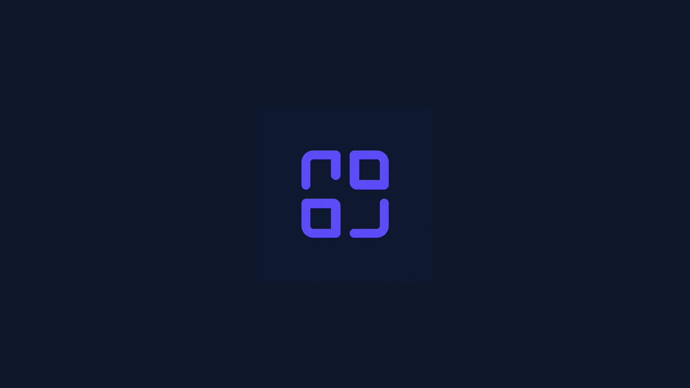
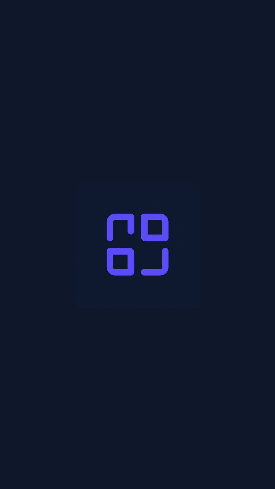

# QRFolio

An offline-first web app for creating, scanning, organizing, and sharing QR codes. Your library lives in your browser, with JSON backups for recovery and transfer.



**Initial preview · MIT · React 19 · TypeScript · Vite 8**

## Features

- Create URL, text, Wi-Fi, email, phone, SMS, contact, location, calendar, and cryptocurrency QR codes.
- Customize QR colors, organize records into categories, search your library, and mark favorites.
- Scan with a camera where supported, with confirmation before opening scanned links.
- Export and restore validated JSON backups containing QR codes, categories, and settings.
- Use cached local workflows offline after the first production load; install as a PWA where supported.
- Responsive desktop and mobile layouts, keyboard controls, and reduced-motion settings.

<details>
<summary>Mobile splash artwork</summary>



</details>

## Quick start

Use **Node.js 24.x** and **npm 12.x**. No account, backend, API key, or environment file is required.

```sh
git clone https://github.com/PatzMain/QRFOLIO.git
cd QRFOLIO
npm ci
npm run dev
```

Open the URL printed by Vite. Development serves HTTPS on port 5173 and listens on the local network. Its self-signed certificate may cause a browser warning. Camera and installation behavior require a trusted secure context; use a trusted HTTPS host for device testing.

Development does not enable the production service worker. To try offline behavior, use a production build:

```sh
npm run build
npm run preview -- --host 127.0.0.1
```

Open the printed preview URL online. Wait for the service worker to activate and control the page, then reload before switching offline. Keep using that same origin. A phone's localhost refers to the phone, so use a trusted HTTPS deployment for phone testing.

## Development and testing

```sh
npm test                 # production build, ESLint, and Vitest
npm run notices:check    # lockfile, installed dependency and retained notice verification
npm audit --audit-level=moderate
```

Tests use synthetic data and isolated in-memory IndexedDB. See [CONTRIBUTING.md](CONTRIBUTING.md) for contribution guidance, [architecture.md](architecture.md) for the application structure, [VERIFICATION.md](VERIFICATION.md) for initial preview results, and [PUBLICATION.md](PUBLICATION.md) for browser checks and the release checklist.

## Deployment

Build with `npm ci` followed by `npm run build`, then serve `dist/` from a trusted HTTPS static host. The application expects the **origin root** (`/`); deployment under a URL subdirectory requires additional routing and PWA configuration.

- **Vercel:** use the Vite preset and `dist` output. The included `vercel.json` provides SPA rewrites and service-worker cache headers.
- **Netlify or Cloudflare Pages:** use `npm run build`, output `dist`, and add `public/_redirects` containing `/* /index.html 200` before building.
- **Other hosts:** return `index.html` for application routes such as `/settings` and `/detail/:id`, while serving static assets normally. Serve `sw.js` with revalidation rather than a long immutable cache.

Verify direct route reloads, camera permissions, offline loading, and updates on your chosen host. A new waiting service worker displays an update banner; users can apply it or snooze it for the session.

## Privacy and limitations

Library records are stored in IndexedDB on this browser and origin. There is no account, library-sync backend, or analytics in the application source. Initial assets and service-worker updates contact the host. Deliberate external actions may send QR content to websites, Google Maps, Google Search, email/SMS/wallet applications, or the device share sheet.

**Storage and backups are not encrypted.** Wi-Fi passwords and contact details remain readable. Treat shared QR images and backup files accordingly. Browser storage can be cleared or evicted; export backups regularly.

Backups are limited to **10 MiB**, **10,000 QR codes**, and **1,000 categories**. Version 1 backups remain importable; version 2 also restores settings. Import adds missing categories, replaces QR records with matching IDs, and preserves unrelated records. Invalid input or a failed transaction leaves the existing library unchanged. Export your library before importing another backup.

Physical camera/lens/torch behavior, mobile installation, manual screen-reader behavior, and recovery after browser storage eviction need acceptance checks on the actual device. Cryptocurrency validation checks basic address shape for Bitcoin/Ethereum; it does not verify ownership, checksums, network, or wallet transaction compatibility.

Report ordinary bugs through repository issues. For vulnerabilities, follow [SECURITY.md](SECURITY.md) and use private reporting.

## License and credits

Owned application source and documentation are available under the [MIT license](LICENSE), Copyright (c) 2026 PatzMain. Dependencies and fonts retain their own terms; see [THIRD_PARTY_NOTICES.md](THIRD_PARTY_NOTICES.md). Keep the notices in source and built distributions.

App-specific icons, screenshots, and hero artwork were created by the maintainer using AI image generation. Inter fonts and the React/Vite template SVGs retain their upstream attribution.

Built by **Patz**.
